<div align="center">



<br>

<sub><a href="#about">about</a> &nbsp;/&nbsp; <a href="#skill-tree">skill tree</a> &nbsp;/&nbsp; <a href="#traffic">traffic</a> &nbsp;/&nbsp; <a href="#snake">snake</a> &nbsp;/&nbsp; <a href="#contact">contact</a></sub>

</div>

<br>

## about

<div align="center">

</div>

<br>

Network analyst & sysadmin. Kerjaan utamanya: bikin jaringan tetap hidup, cari tahu kenapa dia mati, lalu bikin script biar nggak mati dengan cara yang sama dua kali.

```text
role      Network Analyst & Sysadmin
daily     Linux · Bash · Python · Cisco · Wireshark
habit     baca packet capture sebelum nyalahin siapa pun
status    ONLINE
```

<br>

## skill tree

Skill saya gambar sebagai topologi jaringan. Node yang menyala sudah *unlocked*, yang berkedip lagi *training*, yang gelap belum disentuh. Pip di bawah node = level.

<div align="center">

</div>

<details>
<summary>versi teks (kalau gambar nggak kebuka)</summary>

<br>

| branch | unlocked | training | locked |
| --- | --- | --- | --- |
| automation | Linux, Bash, Python | Ansible | |
| networking | TCP/IP, Cisco IOS, Wireshark | BGP | |
| ops & observability | Monitoring, Grafana | Docker | Kubernetes |

</details>

<br>

## traffic

<div align="center">

</div>

<br>

```text
$ fanops --now
learning   Ansible          # next unlock
building   script monitoring buat homelab
reading    RFC, dan log yang nggak ada yang mau baca
```

<br>

## snake

<div align="center">

<br>

</div>

<br>

## contact

```text
github    https://github.com/alfannite
email     you@example.com
```

<br>

<div align="center">

</div>
